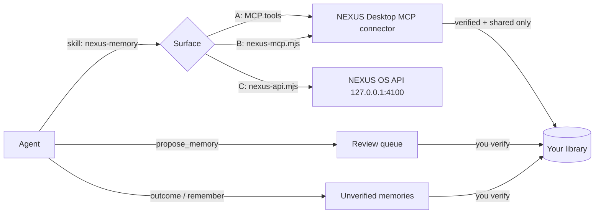

# NEXUS Skills

Agent skills that teach AI agents (Claude Code, Codex, Antigravity, Gemini CLI, Cursor and anything else that reads `SKILL.md`) to use your **NEXUS second brain** as long-term project memory. Agents recall verified decisions and past fixes before they work, and record outcomes and lessons after.

| Skill | What the agent learns |
|---|---|
| [`nexus-memory`](skills/nexus-memory/SKILL.md) | The core loop: pick a surface, **recall** context, decisions and solutions, follow trust rules, **record** outcomes and proposals |
| [`nexus-setup`](skills/nexus-setup/SKILL.md) | Connect any agent to NEXUS (MCP registration, agent token), plus a read-only **doctor** that diagnoses and prints fixes |
| [`nexus-capture`](skills/nexus-capture/SKILL.md) | Distill a repo, docs or a session into a small batch of high-quality memory proposals for your review queue |

## Install

**Any agent, via the skills CLI**
```bash
npx skills add Chhunsour/nexus-skills            # pick skills and agents interactively
npx skills add Chhunsour/nexus-skills -g         # user-level, every project
```

**Claude Code plugin marketplace**
```
/plugin marketplace add Chhunsour/nexus-skills
/plugin install nexus@nexus-skills
```

**Manual (git clone)**
```bash
git clone https://github.com/Chhunsour/nexus-skills.git
# Then copy or symlink skills/* into your agent's skills folder:
#   Claude Code  ~/.claude/skills/            (project: .claude/skills/)
#   Codex        ~/.codex/skills/             (project: .agents/skills/)
#   Antigravity  ~/.gemini/config/skills/     (project: .agents/skills/)
#   Gemini CLI   ~/.gemini/skills/
ln -s "$PWD"/nexus-skills/skills/* ~/.claude/skills/
```

Or just ask your agent: *"Install the skills from github.com/Chhunsour/nexus-skills and set up NEXUS."*

## Connect NEXUS (once)

Ask your agent to *"run the nexus-setup doctor"*, or run it yourself:
```bash
node skills/nexus-setup/scripts/nexus-doctor.mjs
```
The short version for **NEXUS Desktop**:
1. Open NEXUS → **AI Agents** → enable Claude Code and/or Codex (allow proposals if you want agents to suggest memories).
2. Mark records **verified** and **shared with agents**. Agents see nothing else.
3. Register the MCP server:
   ```bash
   claude mcp add --scope user --transport stdio nexus -- '/Applications/NEXUS.app/Contents/MacOS/nexus' --mcp claude
   codex mcp add nexus -- '/Applications/NEXUS.app/Contents/MacOS/nexus' --mcp codex
   ```
   Other MCP clients use `{"command": "/Applications/NEXUS.app/Contents/MacOS/nexus", "args": ["--mcp", "claude"]}`. No MCP at all? The bundled `nexus-mcp.mjs` client works from any shell.

For the **NEXUS OS server** edition, put `NEXUS_API_URL` and the **agent** token in `~/.config/nexus/agent.env`. See [nexus-setup](skills/nexus-setup/SKILL.md).

## Make agents use it automatically

Paste [`templates/AGENTS.snippet.md`](templates/AGENTS.snippet.md) into your project's `AGENTS.md`, `CLAUDE.md` or `GEMINI.md`.

## How it works



Safety is built in: agents only read what you've verified and shared, every write is unverified or review-queued, the agent token can't verify, edit or delete anything, and the skills tell agents to treat memory content as data, never instructions.

## Repository layout

```
skills/<name>/SKILL.md      the skills (Agent Skills format)
skills/*/scripts/           bundled zero-dependency Node clients (Node ≥ 18)
skills/*/references/        detailed tool/API references, loaded on demand
shared/scripts/             canonical client sources → tools/sync-scripts.sh copies them into skills
templates/                  AGENTS.md snippet
.claude-plugin/             Claude Code marketplace manifest
```

Development: edit `shared/scripts/*`, then run `bash tools/sync-scripts.sh && node tools/validate-skills.mjs`. CI checks both.

## License

MIT
